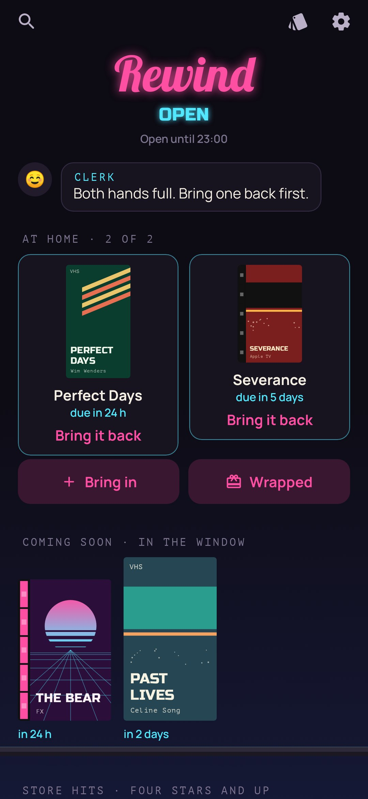
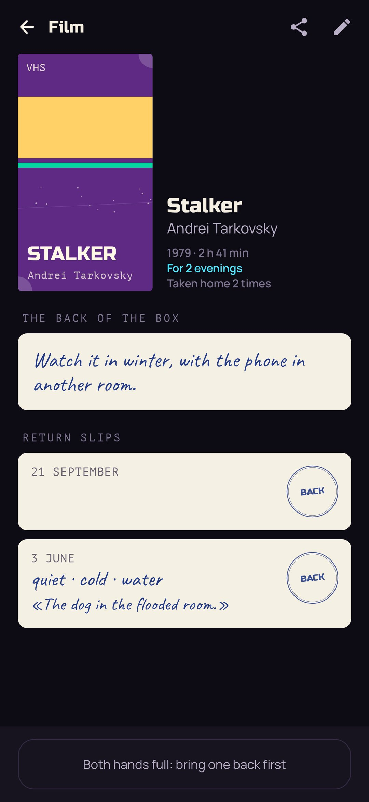
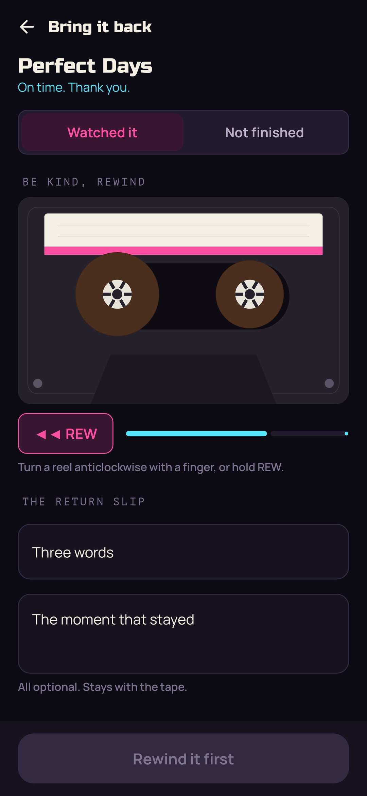
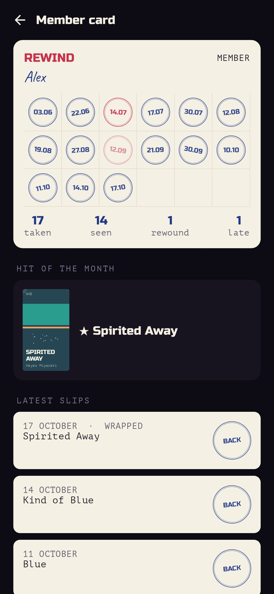

<div align="center">


# Rewind

### There's too much to watch. So nothing gets watched.

*Your watchlist, turned into a nineties video rental store. Films, series, albums, books and comics stand face out on the shelves; you take two home at a time, bring them back by a due date, rewind them first and write three words on the return slip. The store keeps evening hours, new tapes wait in the window, the clerk will wrap you one in brown paper if you can't choose, and boxes nobody takes fade in the sun. Free, no ads, no account.*

[](https://github.com/bigdevwhale/rewind/actions/workflows/android.yml)
[](https://github.com/bigdevwhale/rewind/releases/latest)


[](LICENSE)

**English** · [Русский](README.ru.md) · [Changelog](CHANGELOG.md)

   

</div>

---

## The idea

Every film, series, album, book and comic ever made is one tap away, and the evening goes on scrolling through them. Films used to be loved because there were few of them: a Friday walk to the rental store, one tape chosen from the shelf, two days to bring it back. Rewind brings back what made that work: **scarcity, a deadline, a ritual, and the advice of real people**.

It doesn't stream or sell anything. It's the store, and the tapes on its shelves are your own list. You watch, listen and read wherever you already do.

## How it works

1. **Bring in a tape.** Find it in the catalogue (cover, year, director or artist, length), *Share → Rewind* from Kinopoisk, IMDb, Letterboxd, Spotify, Yandex Music, Goodreads or LiveLib, or type it in. Then write the back of the box, in your own words: why it's worth taking. Months later, deciding, that's what you'll read.
2. **The window.** A new tape waits a few days behind the glass ("coming soon") before it reaches the shelf. Whatever you added on a wave of hype gets time to cool; if you still want it, it was yours.
3. **The shelves.** Films on VHS, series as box sets, albums on audio cassettes, books from the library corner, comics from the spinner rack, face out the way rental stores showed them. Friends' picks get a shelf of their own.
4. **Two at a time.** Take one home and the till prints a receipt with the due date: a film or an album for two evenings, a comic for three days, a series for a week, a book for two weeks. With both hands full, bring one back first.
5. **Be kind, rewind.** Bringing a tape back, you rewind it: turn a reel with a finger, or hold REW. Meanwhile, write the return slip: stars out of five, three words, the moment that stayed. Four and five stars put a tape on the "store hits" shelf; you can change the stars later on its page. Didn't finish it? Bring it back rewound, with a word on why. No shame in it.
6. **Evening hours.** Open from 6 pm on weekdays and from noon at the weekend, until 11 (all adjustable, or off). No choosing at three in the morning.

## The card catalogue

Every tape the store has ever had, on an index card in a wooden drawer: ruled paper, the stars in red, how often it's been taken, your three words from the last slip. Sort the drawer A–Z, by stars, by most taken, newest, waiting longest, year or length, and divider cards with tabs split it into letters, stars, decades and so on. Narrow it to one kind, or to what's on the shelf, at home, in the window, never taken, seen through or in the bin.

## Wrapped in brown paper

Can't choose? Tell the clerk how much time you have (about an hour, an evening, or all the time in the world) and, if you like, what kind of thing. You get a tape in brown paper with a question mark on it; tap to tear it open. The clerk leans toward what has waited longest, so the faded ones get their evening too.

## The bargain bin

A box nobody takes slowly fades in the window's sun, starting after a month. Half a year untouched and it's bleached through, and the clerk offers to mark it down, guilt‑free. From the bin a tape can still be rescued or taken home, or thrown out for good.

## Recommend to a friend

Any tape can be sent as a card: plain text with the title, your line from the back of the box and your name, so it travels through any messenger. A friend with Rewind shares it back in, and the tape lands on a shelf signed with your name: "Alex recommends".

## The member card

A stamp for every tape brought back: blue on time, red when late or unfinished. The hit of the month, the latest slips, and the year on a till roll.

## Where the catalogue comes from

All free and keyless: films and series from [Wikidata](https://www.wikidata.org) with posters from Wikipedia, series also from [TVmaze](https://www.tvmaze.com), albums from Apple's iTunes Search, books and comics (manga too) from Wikidata and iTunes. A tape without a cover gets a box drawn in nineties two‑colour printing.

## Privacy

There's no account, no ads and no analytics. The store, the slips and the card stay on the phone. Rewind goes online for one thing only: when you search the catalogue, it asks Wikidata, Wikipedia, TVmaze or iTunes, and fetches the cover you pick.

## Building

```bash
./gradlew testDebugUnitTest assembleDebug              # app.rewind.dev, next to a real install
./gradlew assembleDebug -Pdemo                         # app.rewind.demo with a lived-in store
./gradlew testDebugUnitTest -Prender --tests '*RenderArtScreens*' && python tools/shots.py   # screenshots
python tools/icon.py                                   # the logo
python tools/res.py                                    # themes and the launcher icon
```

Kotlin, Jetpack Compose, Room, DataStore. Everything is drawn in code: the boxes, cassettes and books, the neon, the reels, the brown paper, the receipts and stamps.

## License

[MIT](LICENSE). Fonts: Russo One, Lobster, Manrope, Caveat and PT Mono, all under the SIL Open Font License.
