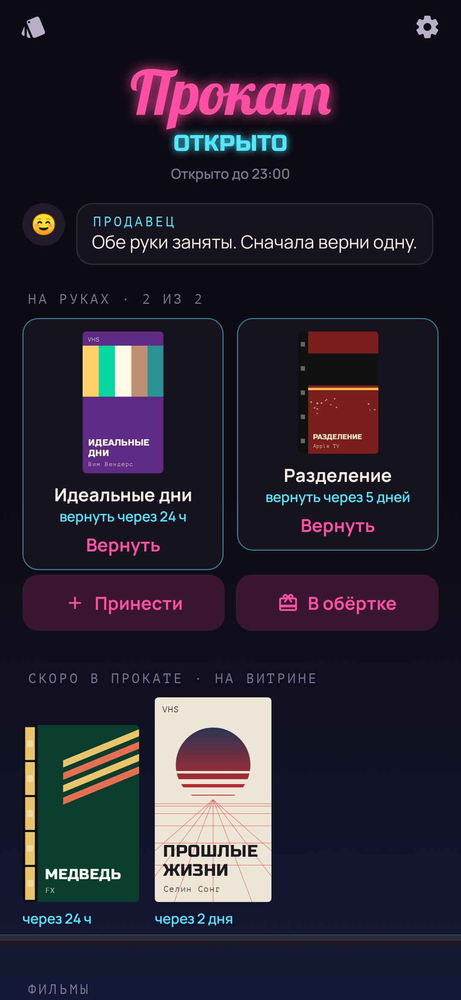
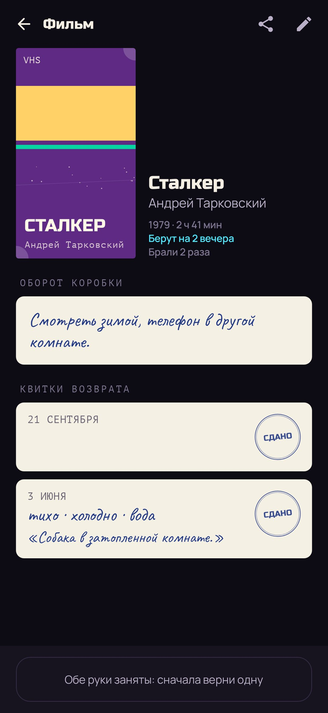
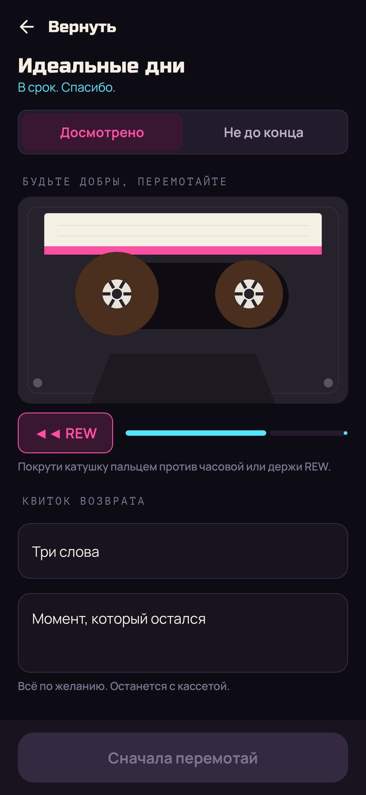
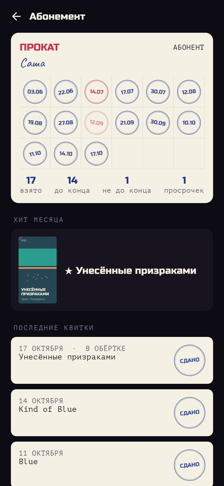

<div align="center">


# Прокат

### Смотреть стало слишком много. Поэтому не смотрим ничего.

*Твой список «посмотреть потом» в виде видеопроката девяностых. Фильмы, сериалы, альбомы и книги стоят на полках лицом к тебе. На руках две кассеты, вернуть нужно к сроку, перед возвратом перемотать и написать на квитке три слова. Прокат работает по вечерам, новинки ждут на витрине, а если не можешь выбрать, продавец завернёт кассету в обёрточную бумагу. Коробки, которые никто не берёт, выцветают на солнце. Бесплатно, без рекламы и аккаунта.*

[](https://github.com/bigdevwhale/rewind/actions/workflows/android.yml)
[](https://github.com/bigdevwhale/rewind/releases/latest)


[](LICENSE)

[English](README.md) · **Русский** · [Изменения](CHANGELOG.md)

   

</div>

---

## Идея

Все фильмы, сериалы, альбомы и книги мира в одном касании, а вечер уходит на то, чтобы их листать. Раньше кино любили, потому что его было мало: в пятницу идёшь в прокат, выбираешь с полки одну кассету, через два дня её надо вернуть. «Прокат» возвращает то, на чём это держалось: **дефицит, срок, ритуал и советы живых людей**.

Приложение ничего не показывает и не продаёт. Это сам прокат, а кассеты на полках — твой собственный список. Смотреть, слушать и читать можно там, где привык.

## Как это устроено

1. **Принести кассету.** Найди её в каталоге (обложка, год, режиссёр или исполнитель, длительность), поделись из Кинопоиска, IMDb, Letterboxd, Spotify, Яндекс Музыки, Goodreads или LiveLib, или впиши вручную. Потом заполни оборот коробки своими словами: почему это стоит взять. Через полгода, выбирая, ты прочитаешь именно это.
2. **Витрина.** Новая кассета несколько дней стоит за стеклом («скоро в прокате») и только потом попадает на полку. То, что добавлено на волне хайпа, успевает остыть. Если всё ещё хочется, значит, это твоё.
3. **Полки.** Фильмы на VHS, сериалы в бокс-сетах, альбомы на аудиокассетах, книги из библиотечного уголка, все стоят лицом к тебе, как в настоящем прокате. У советов друзей своя полка.
4. **Две кассеты на руках.** Берёшь кассету, и касса печатает чек со сроком возврата: фильм или альбом на два вечера, сериал на неделю, книга на две недели. Когда обе руки заняты, сначала верни одну.
5. **Будьте добры, перемотайте.** Перед возвратом кассету надо перемотать: покрути катушку пальцем или держи REW. Пока она мотается, заполни квиток: три слова и момент, который остался. Не получилось до конца? Верни перемотанной и напиши, почему не пошло. Это нормально.
6. **Вечерние часы.** По будням с шести вечера, в выходные с полудня, до одиннадцати. Часы можно поменять или отключить. Никакого выбора в три часа ночи.

## В обёрточной бумаге

Не можешь выбрать? Скажи продавцу, сколько у тебя времени (около часа, целый вечер или сколько угодно) и, если хочешь, что именно. Получишь кассету в коричневой бумаге со знаком вопроса, рви её тапами. Продавец охотнее выбирает то, что ждёт дольше всех, так что и выцветшим достаётся свой вечер.

## Уценка

Коробка, которую никто не берёт, через месяц начинает выцветать на солнце у витрины. Полгода без дела, и она выгорает полностью. Тогда продавец предлагает её уценить, без чувства вины. Из корзины кассету ещё можно спасти, взять домой или списать насовсем.

## Посоветовать другу

Любую кассету можно отправить карточкой: это простой текст с названием, твоей строчкой с оборота коробки и подписью, поэтому он пройдёт через любой мессенджер. Друг с «Прокатом» делится ею обратно в приложение, и кассета встаёт у него на полку с твоим именем: «Саша советует».

## Абонемент

Штамп за каждую возвращённую кассету: синий, если в срок, красный при просрочке или если не до конца. Хит месяца, последние квитки и год на кассовой ленте.

## Откуда каталог

Всё бесплатно и без ключей: фильмы и сериалы из [Wikidata](https://www.wikidata.org) с постерами из Википедии, сериалы ещё из [TVmaze](https://www.tvmaze.com), альбомы и книги из поиска iTunes. Кассете без обложки коробка рисуется сама, в двухцветной полиграфии девяностых.

## Приватность

Нет аккаунта, рекламы и аналитики. Прокат, квитки и абонемент хранятся только на телефоне. В интернет приложение ходит ради одного: при поиске по каталогу оно спрашивает Wikidata, Википедию, TVmaze или iTunes и скачивает выбранную обложку.

## Сборка

```bash
./gradlew testDebugUnitTest assembleDebug              # app.rewind.dev, рядом с основной установкой
./gradlew assembleDebug -Pdemo                         # app.rewind.demo с обжитым прокатом
./gradlew testDebugUnitTest -Prender --tests '*RenderArtScreens*' && python tools/shots.py   # скриншоты
python tools/icon.py                                   # логотип
python tools/res.py                                    # темы и иконка
```

Kotlin, Jetpack Compose, Room, DataStore. Всё нарисовано кодом: коробки, кассеты и книги, неон, катушки, обёрточная бумага, чеки и штампы.

## Лицензия

[MIT](LICENSE). Шрифты Russo One, Lobster, Manrope, Caveat и PT Mono распространяются под SIL Open Font License.
